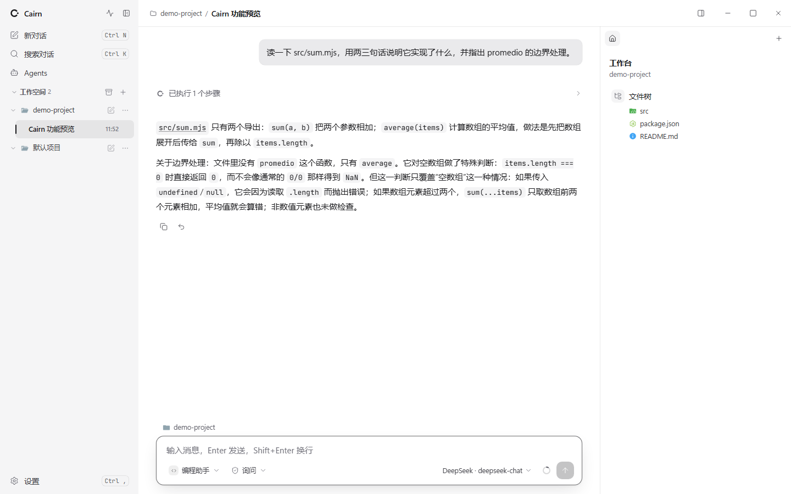
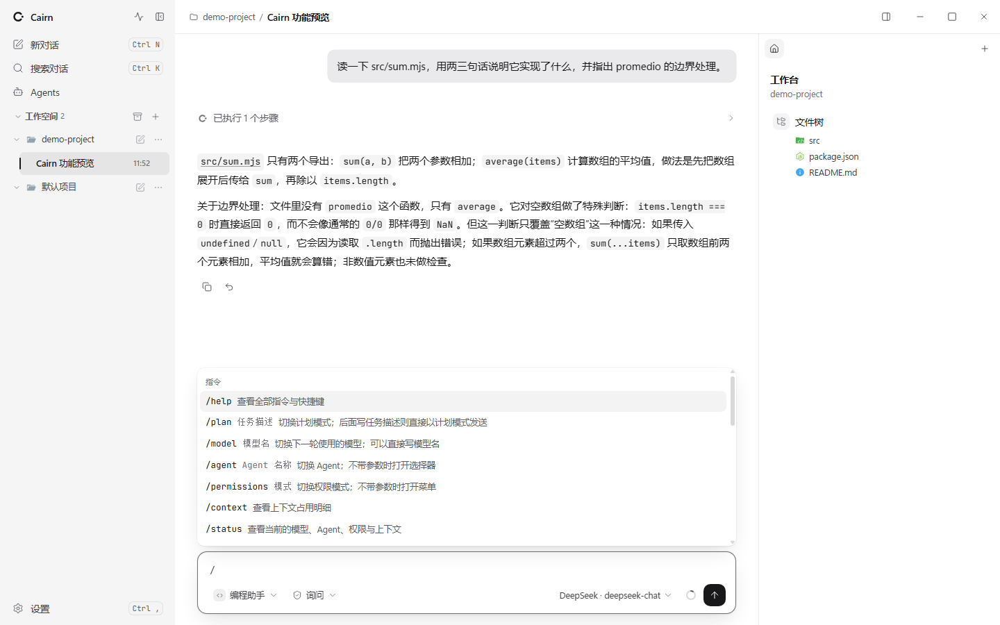
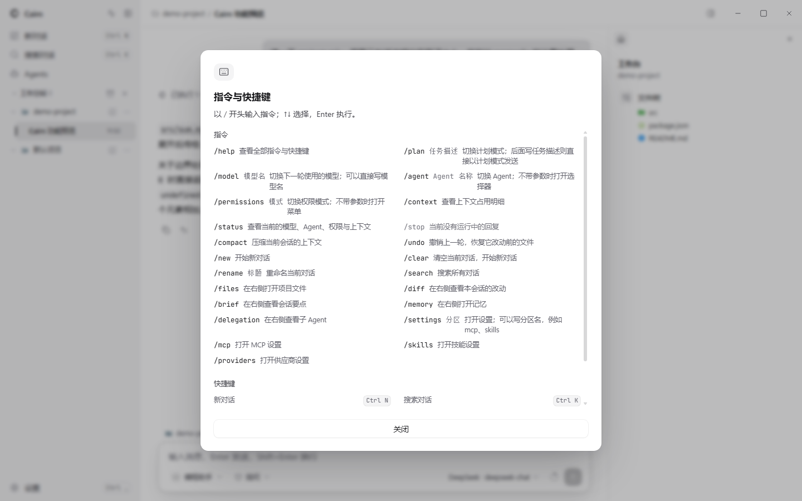
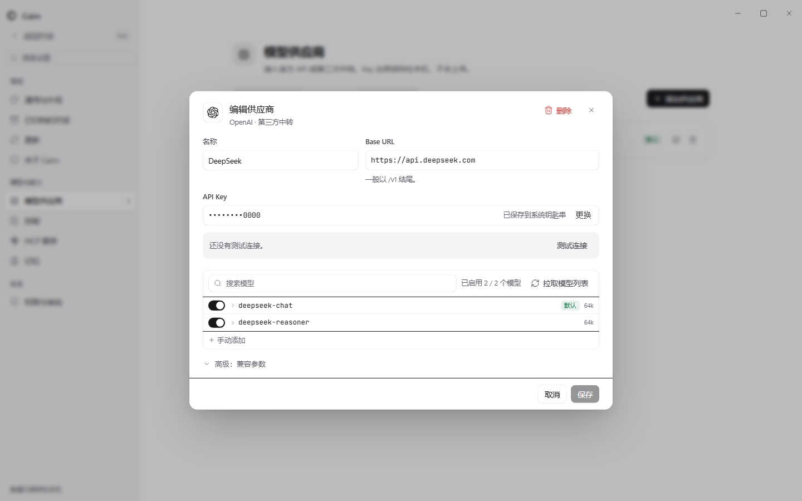
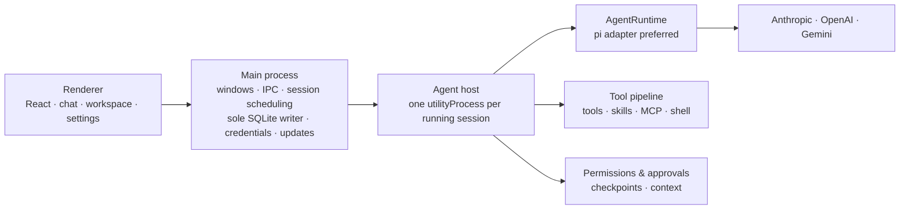

# Cairn

<p align="center">
  <picture>
    <source media="(prefers-color-scheme: dark)" srcset="docs/images/home-dark.png">
    
  </picture>
</p>

<p align="center">
  A Codex-like desktop coding agent<br>
  <strong>Our own agent platform + a pluggable agent engine</strong> (pi preferred)
</p>

<p align="center">
  <a href="README.md">中文</a> · English
</p>

## What it is

Cairn is a **local-first** desktop coding agent. Pick a local project folder, describe a task in
natural language, and the agent reads code, edits files and runs commands on its own. Every step,
tool call and file change is visible in the UI; sensitive actions require approval, and every
change can be rolled back.

Architecturally, Cairn = **our own agent platform** + **a pluggable agent engine**:

- **Platform (ours)**: run orchestration, context, the tool registry and tool pipeline, permissions
  and approvals, checkpoints, the event log, storage, credentials, UI, and multi-agent
  collaboration.
- **Engine (replaceable)**: only the agent loop (call the model → parse tool calls → feed results
  back) and model communication, plugged in through the `AgentRuntime` interface; pi is the
  preferred engine. Tool execution stays in the platform, so swapping engines does not affect
  permissions, auditing or storage.

> **Status**: 0.1.x beta, MIT licensed. M0–M8 are implemented; Windows is installable, macOS ships
> ad-hoc signed (not notarized) DMG/ZIP builds, and Linux ships AppImage/deb. The three-platform CI
> matrix and per-platform release pipeline landed in M6 (see the
> [M6 acceptance report](docs/plan/m6-report.md)). M7 added cross-session memory and team
> templates (review loops, pipelines, draft trials, and desktop editing with version history);
> M8 added PR auto-fix. See the [M7 acceptance report](docs/plan/m7-report.md) and the
> [M8 plan and acceptance](docs/plan/m8.md). Stable is still blocked on code signing, legal
> review and a clean-VM acceptance matrix. Windows x64 ships first, per-user install.

## Highlights

- **Local first**: sessions, projects, file changes and checkpoints live in local SQLite. API keys
  are encrypted with the OS secure storage (safeStorage); no cloud account needed.
- **Controlled**: tool calls are shown live; writing files and running commands require approval by
  default; project-level permission rules and sandboxed execution are supported.
- **Reviewable**: diffs per file and per hunk; accept or revert a single file or hunk, or return to
  any checkpoint.
- **Multi-model**: Anthropic, OpenAI and Gemini protocol formats, with custom `baseUrl`; services
  like DeepSeek work through the OpenAI-compatible format.
- **Extensible**: built-in tools, skills, MCP servers, custom agents, delegation and isolated
  workspaces all go through one tool registry.
- **Remembering**: agents can remember project conventions and preferences across sessions. Items
  are strictly scoped to this session / this project / all projects, written only after you confirm
  by default, and can be edited or deleted at any time.
- **Collaborative**: common multi-agent setups can be saved as team templates with maker/checker
  review loops, fixed-stage pipelines and draft trials; templates are versioned and published like
  agents.
- **Observable**: activity center, background commands, run inspector, context usage and redacted
  diagnostics bundles.
- **Self-healing**: watch a PR for failing CI, merge conflicts and new review comments; Cairn opens
  a fix session, edits and verifies the code in an isolated worktree, then pushes to the PR branch.
  It never merges or force-pushes, and stops with a notification once attempts run out.
- **Handy**: type `/` in the composer for 20+ built-in commands, and `/help` for the full command
  and shortcut list; switch agents, change the permission mode or check context and run status
  without leaving the chat.

## Screenshots

| Chat and tool timeline | Change review |
| --- | --- |
|  |  |
| **Built-in commands** | **Commands and shortcuts** |
|  |  |
| **Model providers** | **Dark theme** |
|  |  |

> The chat screenshots come from a real DeepSeek model run, for illustration only; actual content
> depends on the model you configure.

## Architecture



Three key boundaries:

- **UI ↔ main process**: the UI has no Node access; it can only call the typed API exposed by the
  preload script.
- **Main process ↔ agent host**: one process per session, so a crash or hang does not affect the
  window or other sessions.
- **Business code ↔ engine**: only `packages/runtime-pi` may reference pi; everything else uses the
  `AgentRuntime` interface.

See [architecture](docs/architecture.md) and the [ADRs](docs/adr/README.md) for details.

## Repository layout

```text
apps/desktop           Electron app (main / preload / renderer / agent-host)
packages/core          Domain types, AgentRuntime interface, permission engine, path validation
packages/protocol      IPC protocol and event definitions (zod schemas + TS types)
packages/runtime-pi    pi adapter (the only package allowed to reference pi)
packages/tools         Built-in tool implementations
packages/skills        Skill parsing, indexing and on-demand loading
packages/mcp           MCP client, connection management and tool adaptation
packages/shell         Shell adapters (PowerShell / cmd / bash / zsh)
packages/checkpoint    Checkpoint implementation
packages/storage       Storage interfaces, SQLite implementation and migrations
packages/i18n          Chinese and English string resources
```

## Quick start

Requires **Node 24.11+** (matching the Node major inside Electron 45) and **pnpm 10**
(`corepack enable`).

```bash
pnpm install
pnpm typecheck
pnpm test
pnpm dev     # run the app in development mode (data goes to a separate Cairn-dev folder)
pnpm build   # build the desktop app
pnpm smoke   # startup smoke test against the build output
pnpm e2e     # end-to-end tests against the build output (Playwright; on headless Linux use xvfb-run -a pnpm e2e)
```

Install-form acceptance (Windows; build the package first):

```bash
pnpm package:dir; pnpm e2e:packaged        # unpacked output: installed-form smoke + full release flow
pnpm package:nsis; pnpm acceptance:installed  # real NSIS: install / uninstall / reinstall recovery
```

See [install](docs/dev/install.md) and [troubleshooting](docs/dev/troubleshooting.md).

## Plan

- Shipping platform: Windows first; macOS beta uses ad-hoc signing (not notarized), and its stable
  channel opens after Developer ID signing, notarization and real-device install acceptance.
  Linux packaging and the per-platform release pipeline landed in M6 (see the
  [M6 acceptance report](docs/plan/m6-report.md)).
- Initial models: Anthropic, OpenAI and Gemini protocol formats; services like DeepSeek use the
  OpenAI-compatible format.
- UI languages: Chinese and English; light, dark and follow-system themes.
- Memory and team collaboration landed in M7: memory is scoped to session / project / global, and
  team templates support review loops, pipelines, draft trials and three built-in templates. They
  can be created, edited, version-compared, restored, duplicated and archived in the desktop app
  (see the [M7 acceptance report](docs/plan/m7-report.md)).
- PR auto-fix landed in M8: enable a watch with `watch_pull_request` in a session. Failing CI,
  merge conflicts or new review comments start an unattended fix session in an isolated worktree,
  which pushes to the PR's head branch. It never merges or force-pushes (see the
  [auto-fix design](docs/plan/auto-fix.md) and the [M8 plan and acceptance](docs/plan/m8.md)).
- Stable still needs code signing, legal review and a clean-VM acceptance matrix.

## Docs

- [Architecture / 架构设计](docs/architecture.md)
- [Architecture decision records / 架构决策记录](docs/adr/README.md)
- [Agent Runtime](docs/design/agent-runtime.md) (accepted)
- [Agent management UI](docs/design/agent-management-ui.md) (accepted)
- [Multi-agent collaboration](docs/design/multi-agent.md) (accepted)
- [Install, upgrade and uninstall](docs/dev/install.md)
- [Credential storage](docs/dev/credentials.md)
- [Troubleshooting](docs/dev/troubleshooting.md)
- [M5 release acceptance report](docs/plan/m5-report.md)
- [M6 acceptance report](docs/plan/m6-report.md)
- [M7 acceptance report](docs/plan/m7-report.md)
- [Auto-fix design](docs/plan/auto-fix.md)
- [M8 plan and acceptance](docs/plan/m8.md)
- [Changelog](CHANGELOG.md)
- [Privacy notice](PRIVACY.md)
- [Contributing](CONTRIBUTING.md)
- [Code of conduct](CODE_OF_CONDUCT.md)
- [Security policy](SECURITY.md)

## Milestones

- [M0 Foundations](docs/plan/m0.md)
- [M1 Minimum viable](docs/plan/m1.md)
- [M2 Reviewable](docs/plan/m2.md)
- [M3 Daily usable](docs/plan/m3.md)
- [M4 Multi-agent collaboration](docs/plan/m4.md)
- [M5 Release](docs/plan/m5.md)
- [M6 Cross-platform and open source](docs/plan/m6.md)
- [M7 Memory and collaboration](docs/plan/m7.md)
- [M8 Auto-fix](docs/plan/m8.md)

## License

[MIT](LICENSE). Third-party components keep their own licenses; see the bundled notices and
[ADR-0039](docs/adr/0039-open-source-license-and-dco.md). Contributions are accepted under the
DCO (`git commit -s`).

Author: 960602906
