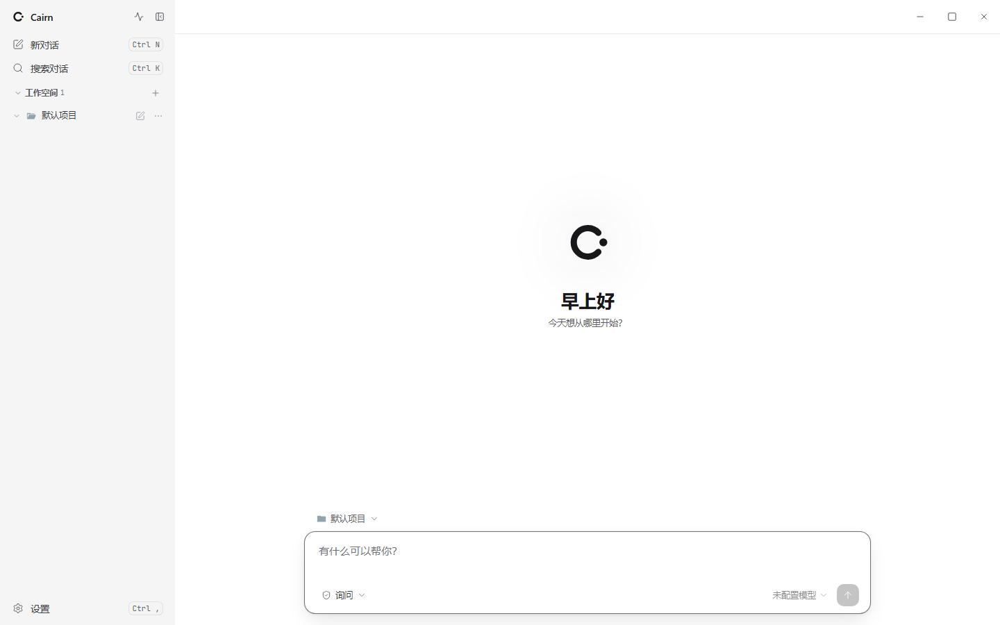
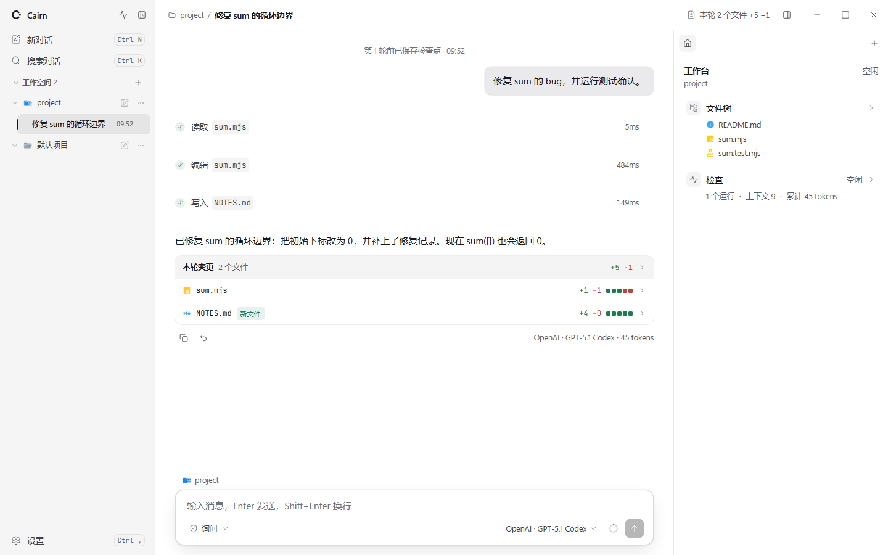
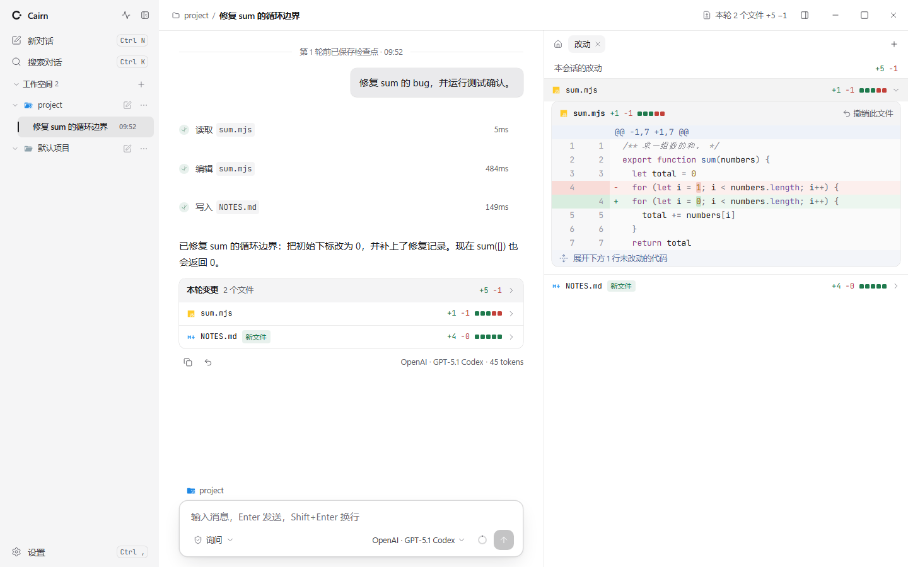
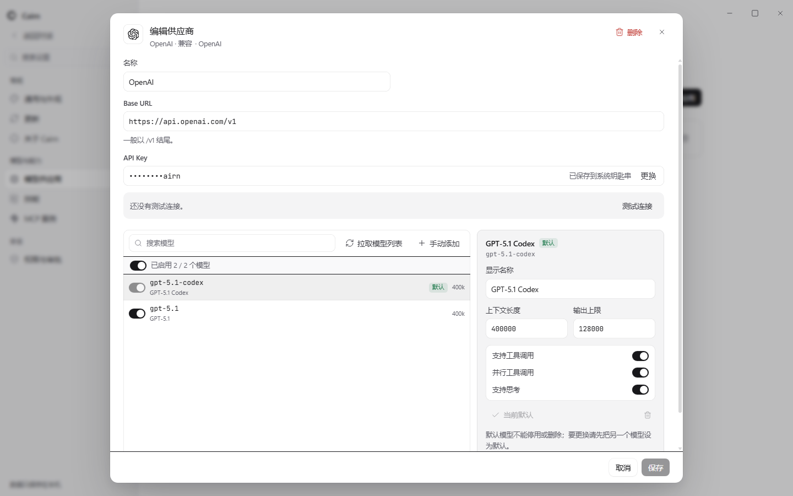
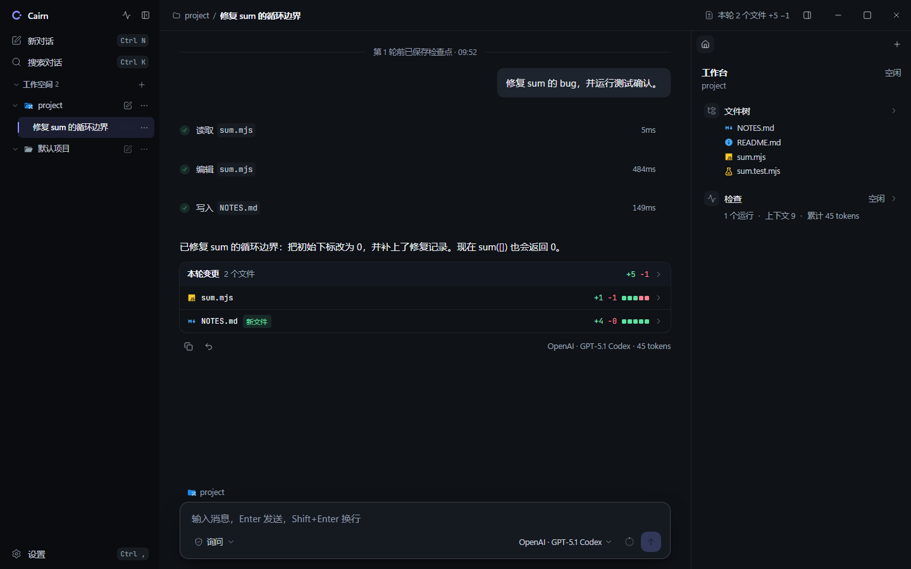
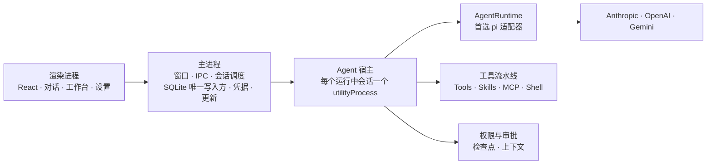

# Cairn

<p align="center">
  <picture>
    <source media="(prefers-color-scheme: dark)" srcset="docs/images/home-dark.png">
    
  </picture>
</p>

<p align="center">
  一个类似 Codex 的编程类桌面 Agent 应用<br>
  自研 Agent 平台 + 可插拔 Agent 引擎
</p>

<p align="center">
  A Codex-like desktop coding agent: <strong>our own agent platform + a pluggable agent engine</strong> (pi preferred).
</p>

## 这是什么 / What it is

Cairn 是一个**本地优先**的编程桌面 Agent。选择本地项目目录，用自然语言描述任务，Agent 会自主读代码、改代码、执行命令。整个过程、工具调用和文件改动都在界面中可见；敏感操作需要审批，所有改动都可以回退。

技术上，Cairn = **自研 Agent 平台** + **可插拔 Agent 引擎**：

- **平台层（自研）**：运行编排、上下文、工具注册表与工具流水线、权限与审批、检查点、事件日志、存储、凭据、界面和多 Agent 协作。
- **引擎层（可替换）**：只负责 Agent 循环（调用模型 → 解析工具调用 → 回填结果）与模型通信，经 `AgentRuntime` 接口接入；首选 pi。工具执行仍由平台完成，更换引擎不影响权限、审计和存储。

> **状态**：0.1.0 unsigned beta。M0～M5 已实施，可安装分发；stable 仍被代码签名、法务审查与干净 VM 验收矩阵阻塞。首发 Windows x64，按用户安装。验收证据见 [M5 发布验收报告](docs/plan/m5-report.md)，任务分解见 [docs/plan/m5.md](docs/plan/m5.md)；下一阶段 [M6 跨平台与开源](docs/plan/m6.md) 在规划中。

## 主要特点 / Highlights

- **本地优先**：会话、项目、文件改动和检查点存于本地 SQLite；API Key 经系统安全存储（safeStorage）加密保存，不需要云端账号。
- **可控**：工具调用实时可见；写文件和执行命令默认需要审批；支持项目级权限规则与沙箱执行。
- **可审阅**：按文件和代码块展示 diff，可接受、撤销单个文件或单块改动，也可回到任意检查点。
- **多模型**：支持 Anthropic、OpenAI、Gemini 三种协议格式，可配置自定义 `baseUrl`；DeepSeek 等兼容服务走 OpenAI 格式。
- **可扩展**：内置工具、Skills、MCP 服务、自定义 Agent、委派与隔离工作区进入同一套工具注册表。
- **可观测**：活动中心、后台命令、运行检查器、上下文用量与脱敏诊断包。

## 界面 / Screenshots

| 对话与工具时间线 | 改动审阅 |
| --- | --- |
|  |  |
| **模型供应商** | **深色主题** |
|  |  |

> 截图使用本地模拟模型服务生成，仅用于展示界面；实际内容取决于你配置的模型。

## 架构 / Architecture



三条关键边界：

- **界面 ↔ 主进程**：界面没有 Node 能力，只能调用预加载脚本暴露的类型化 API。
- **主进程 ↔ Agent 宿主**：每个会话一个独立进程，崩溃或卡死不影响窗口和其他会话。
- **业务代码 ↔ 引擎**：只有 `packages/runtime-pi` 允许引用 pi，其他代码通过 `AgentRuntime` 接口使用。

详细设计见[架构设计](docs/architecture.md)与[架构决策记录（ADR）](docs/adr/README.md)。

## 项目结构 / Repository

```text
apps/desktop            Electron 应用（main / preload / renderer / agent-host）
packages/core           领域类型、AgentRuntime 接口、权限引擎、路径校验
packages/protocol       IPC 协议与事件定义（zod schema + TS 类型）
packages/runtime-pi     pi 适配器（唯一可引用 pi 的包）
packages/tools          内置工具实现
packages/skills         Skill 解析、索引与按需加载
packages/mcp            MCP 客户端、连接管理与工具适配
packages/shell          Shell 适配器（PowerShell / cmd / bash / zsh）
packages/checkpoint     检查点实现
packages/storage        存储接口、SQLite 实现与迁移
packages/i18n           中英文文案资源
```

## 快速开始 / Quick start

需要 Node 24.11+（与 Electron 45 内置的 Node 主版本一致）与 pnpm 10（可通过 `corepack enable` 启用）。

```bash
pnpm install
pnpm typecheck
pnpm test
pnpm dev     # 启动桌面应用（开发模式，数据放在独立的 Cairn-dev 目录）
pnpm build   # 构建桌面应用
pnpm smoke   # 用构建产物做启动冒烟测试
pnpm e2e     # 用构建产物跑端到端测试（Playwright；Linux 无显示器时用 xvfb-run -a pnpm e2e）
```

安装形态验收（Windows；需先构建安装包）：

```bash
pnpm package:dir; pnpm e2e:packaged        # 解包产物：安装形态冒烟 + 发布全流程
pnpm package:nsis; pnpm acceptance:installed  # 真实 NSIS：安装 / 卸载 / 重装恢复
```

安装、升级、卸载与故障排查见[安装文档](docs/dev/install.md)和[故障排查](docs/dev/troubleshooting.md)。

## 当前计划 / Plan

- 首发平台：Windows，后续支持 macOS 与 Linux。
- 首批模型：Anthropic、OpenAI、Gemini 三种协议格式；DeepSeek 等兼容服务走 OpenAI 格式。
- 界面语言：中文、英文；主题支持浅色、深色与跟随系统。
- stable 发布前仍需完成代码签名、法务审查与干净 VM 验收矩阵。

## 文档 / Docs

- [架构设计 / Architecture](docs/architecture.md)
- [架构决策记录 / ADRs](docs/adr/README.md)
- [Agent Runtime](docs/design/agent-runtime.md)（已确认）
- [Agent 管理界面](docs/design/agent-management-ui.md)（已确认）
- [多 Agent 协作](docs/design/multi-agent.md)（已确认）
- [安装、升级与卸载 / Install, upgrade and uninstall](docs/dev/install.md)
- [故障排查 / Troubleshooting](docs/dev/troubleshooting.md)
- [聊天区域状态显示优化方案](docs/plan/chat-status-display.md)（待实施）
- [M5 发布验收报告 / M5 release acceptance report](docs/plan/m5-report.md)
- [更新日志 / Changelog](CHANGELOG.md)
- [隐私说明 / Privacy notice](PRIVACY.md)
- [Beta 许可 / Beta license](LICENSE)

## 开发计划 / Milestones

- [M0 基础](docs/plan/m0.md)
- [M1 最小可用](docs/plan/m1.md)
- [M2 可审阅](docs/plan/m2.md)
- [M3 日常可用](docs/plan/m3.md)
- [M4 多 Agent 协作](docs/plan/m4.md)
- [M5 发布](docs/plan/m5.md)
- [M6 跨平台与开源](docs/plan/m6.md)（规划中）

作者 / Author：960602906
