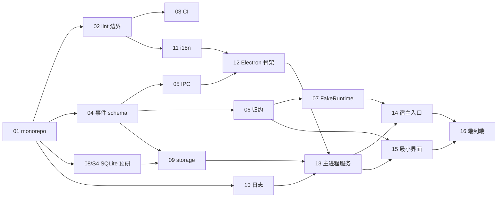

# M0 基础阶段：任务分解

> 状态：草案，执行中按实际情况调整。
> 上级文档：[架构设计](../architecture.md) 第 26、27 节。引用处标注为「ADR-xxxx」「架构 §x」「Runtime §x」（[Agent Runtime 详细设计](../design/agent-runtime.md)）。

## 1. 目标

**完成标准**（架构 §26）：用 `FakeRuntime` 跑通"输入 → 事件 → 落库 → 界面显示 → 重启后恢复"。

M0 不接真实模型，但要把**难改的部分**一次做对：monorepo 与依赖边界、IPC 协议、事件模型、存储格式与迁移、进程模型。同时完成架构 §27 的全部技术预研，结论写回 ADR，为 M1 扫清风险。

### 1.1 不在 M0 范围内

- 真实模型接入、pi 适配器（`packages/runtime-pi`）——只做预研，正式实现在 M1。
- 工具、权限引擎、Shell 适配器、检查点——M1。
- 设置页、diff 视图、终端面板、界面样式打磨——M2。
- 安装包、签名、自动更新——M5。

### 1.2 任务约定

- **一个任务一个 PR**，PR 标题带任务编号，如 `feat(protocol): 事件信封与事件类型 [M0-04]`。
- 每个任务写明：**依赖**、**交付物**、**验收标准**、**依据**（ADR / 章节）。
- 所有 PR 必须通过 CI（M0-03 之后）；纯 TS 包要求单元测试覆盖核心逻辑。
- M0 只创建本阶段用到的包，其余包（`runtime-pi`、`tools`、`shell`、`checkpoint`、`skills`、`mcp`、`ui`）到对应阶段再建，避免空壳。
- 预研代码放在 `spikes/<名称>/`，不加入 pnpm workspace，不进入正式构建；结论写回对应 ADR 并在 ADR 中把状态从"待预研"改为结论。

---

## 2. 任务总览

| 编号 | 任务 | 组 | 依赖 | 可在 Linux 容器完整验证 |
|---|---|---|---|---|
| M0-01 | monorepo 骨架 | A 工程基础 | — | 是 |
| M0-02 | 依赖边界与 lint | A | 01 | 是 |
| M0-03 | CI（Windows + Linux） | A | 02 | 需 GitHub Actions |
| M0-04 | protocol：事件信封与事件类型 | B 领域与协议 | 01 | 是 |
| M0-05 | protocol：IPC 消息与握手 | B | 04 | 是 |
| M0-06 | core：领域类型与事件归约 | B | 04 | 是 |
| M0-07 | core：AgentRuntime 接口与 FakeRuntime | B | 06 | 是 |
| M0-08 | 预研：SQLite 引擎（= S4） | C 基础设施 | 01 | 部分（Windows 打包需 CI） |
| M0-09 | storage：接口、SQLite 实现与迁移 | C | 04、08 | 是 |
| M0-10 | 日志与脱敏 | C | 01 | 是 |
| M0-11 | i18n 骨架 | C | 02 | 是 |
| M0-12 | Electron 应用骨架 | D 进程模型 | 05、11 | 是（无头） |
| M0-13 | 主进程服务 | D | 09、10、12 | 是 |
| M0-14 | Agent 宿主入口 | D | 07、13 | 是 |
| M0-15 | 最小界面 | D | 06、13 | 是 |
| M0-16 | 端到端验收 | D | 14、15 | 是 + Windows CI |
| M0-S1～S8 | 技术预研 | E | 见第 4 节 | 见第 4 节 |

---

## 3. 任务详情

### A. 工程基础

#### M0-01 monorepo 骨架

- **依据**：ADR-0015、ADR-0002；架构 §5、§25
- **交付物**
  - 根目录 `package.json`、`pnpm-workspace.yaml`、`.npmrc`、`.nvmrc`（锁定 Node 版本，与所选 Electron 内置 Node 主版本一致）、`.editorconfig`、`.gitattributes`（统一 LF，`*.ps1` 等按需例外）。
  - `tsconfig.base.json`：`strict`、`noUncheckedIndexedAccess`、`exactOptionalPropertyTypes`、project references。
  - Vitest（workspace 模式）、Prettier。
  - 空包：`packages/protocol`、`packages/core`、`packages/storage`、`packages/i18n`、`apps/desktop`（只有占位入口）。包名统一 `@nexus/<name>`。
  - 根脚本：`pnpm typecheck`、`pnpm lint`、`pnpm test`、`pnpm format`。
- **验收**：全新克隆后 `pnpm install && pnpm typecheck && pnpm test` 在 Windows 与 Linux 上均通过；包之间能通过 workspace 协议互相引用。
- **实施记录**（已完成）
  - TypeScript 锁定 6.0.3：7.x 为原生实现，typescript-eslint（M0-02）依赖的 JS API 尚不可用，待生态跟进后再升级。
  - 内部包的 `exports` 直接指向 `src/*.ts`，由 Vitest 和 electron-vite 处理；`tsc -b` 只做类型检查并输出声明文件，用于 project references。
  - `.nvmrc` 暂定 Node 22，在 M0-12 选定 Electron 版本后与其内置 Node 主版本对齐。
  - `pnpm lint` 在 M0-02 加入。

#### M0-02 依赖边界与 lint

- **依据**：ADR-0015、ADR-0004；架构 §5
- **交付物**
  - ESLint flat config（typescript-eslint），共享配置放根目录。
  - 依赖边界规则（`eslint-plugin-boundaries` 或 `import/no-restricted-paths`，实现时选其一）：
    - `protocol` 不依赖任何 `@nexus/*`；`core` 只依赖 `protocol`。
    - 下层包不得引用上层包和 `apps/*`。
    - 只有 `runtime-pi` 可以引用 `@earendil-works/*`（规则先写好，包到 M1 才建）。
    - `apps/desktop/src/renderer` 禁止引用 Node 内置模块和 `electron`。
  - 每条规则配一个故意违规的测试样例（如 `lint-fixtures/`），在 CI 中断言 lint 报错。
- **验收**：违规样例全部被拦截；正常代码零告警。

#### M0-03 CI

- **依据**：ADR-0014；架构 §18、§23、§24
- **交付物**
  - `.github/workflows/ci.yml`：矩阵 `windows-latest`（必须）+ `ubuntu-latest`；步骤 install（带缓存）→ typecheck → lint → test。
  - `scripts/check-licenses.ts`：遍历生产依赖，只允许 MIT、Apache-2.0、BSD-2/3-Clause、ISC 等，例外列表单独登记。
  - `scripts/check-i18n.ts` 的调用位（脚本本身在 M0-11 完成）。
  - 分支保护建议写入 PR 说明（由仓库所有者在 GitHub 设置）。
- **验收**：两个平台的作业均为绿色；人为引入 GPL 依赖时许可证检查失败。

### B. 领域与协议（纯 TS）

#### M0-04 protocol：事件信封与事件类型

- **依据**：ADR-0005、ADR-0009；架构 §7；Runtime §12
- **交付物**
  - zod 定义 `EventEnvelope`（`v`、`sessionId`、`runId`、`parentRunId?`、`seq`、`ts`、`turnId?`、`stepId?`、`type`、`payload`），按 `type` 做可辨识联合。
  - 架构 §7.2 与 Runtime §12 列出的全部事件类型名一次定下；M0 实际用到的事件（会话、运行、轮次、步骤、消息、`usage.reported`）给出完整 payload schema，其余先给最小 payload，但类型名固定，后续只能向后兼容地追加字段。
  - 区分"持久化事件"和"仅实时事件"（`*.delta`），用类型标注而不是约定。
  - 导出 TS 类型；`parseEvent()` 运行时校验函数。
- **验收**：schema 单元测试覆盖每种事件的合法与非法样例；`*.delta` 无法被传给持久化接口（类型层面报错）。

#### M0-05 protocol：IPC 消息与握手

- **依据**：ADR-0009；架构 §15
- **交付物**
  - 通用信封：请求（`id`、`method`、`params`）、响应（`id`、`result` 或 `error{code, params}`）、事件流消息；超时与错误码定义。
  - 两套接口定义：
    - 渲染 ↔ 主：M0 实现 `session.create`、`session.list`、`session.prompt`、`session.abort`、`session.subscribe`（携带 `afterSeq`）、`session.events`；其余接口（§15.2）先登记名称。
    - 主 ↔ 宿主：`host.init`、`host.prompt`、`host.abort`、`host.shutdown`、`host.event`、`host.heartbeat`；审批相关接口先登记。
  - 传输无关的 `RpcChannel` 实现（输入一个 `postMessage`/`onMessage` 对），供 Electron IPC 与 MessagePort 共用。
  - 握手：交换 `protocolVersion`，不兼容时拒绝并返回明确错误码。
- **验收**：用内存通道测试请求/响应、超时、校验失败、版本不兼容四种情况。

#### M0-06 core：领域类型与事件归约

- **依据**：架构 §7.3；Runtime §5、§17
- **交付物**
  - 领域类型：`CanonicalMessage`、`ContentPart`、`RunState` 与合法转换表、`SessionView`、`RunView`。
  - `reduceSession(view, event)`：纯函数，由事件得到消息列表、会话状态、运行状态；界面和测试共用。
  - delta 合并：实时 delta 只更新"进行中"的消息，收到 `message.assistant.completed` 后以完整内容覆盖。
  - 从持久化事件重建 `CanonicalMessage[]` 历史（供恢复使用）。
- **验收**：状态机合法 / 非法转换全覆盖（Runtime §18）；"只用持久化事件归约"与"持久化 + delta 归约"最终结果一致。

#### M0-07 core：AgentRuntime 接口与 FakeRuntime

- **依据**：ADR-0004、ADR-0016；Runtime §4、§17
- **交付物**
  - 按 Runtime §17 定义 `AgentRuntime`、`RuntimeSession`、`RuntimeSessionInit`、`RuntimeEvent`。
  - `FakeRuntime`：按脚本输出（逐字流式文本、可配置延迟、可选推理内容、可选模拟一次工具调用、可模拟失败），响应 `AbortSignal`。
  - 最小 `RunEngine`：把 `RuntimeEvent` 转成协议事件（无 `seq`，由主进程分配），管理轮次与步骤边界。
  - `RunSupervisor` 只实现单运行版本，接口按 Runtime §17 完整定义。
- **验收**：脚本化场景单测——正常完成、中途 abort（产生 `turn.aborted`）、模型失败（`turn.failed`）、从历史恢复后继续对话。

### C. 基础设施

#### M0-08 预研：SQLite 引擎（= S4）

- **依据**：ADR-0006；架构 §27
- 见第 4 节 S4。结论确定后才开始 M0-09 的 SQLite 实现部分（接口与迁移框架可先写）。

#### M0-09 storage：接口、SQLite 实现与迁移

- **依据**：ADR-0006；架构 §14
- **交付物**
  - 接口：`SessionStore`、`EventStore`（`append(events)` 事务批量写入、`readAfter(sessionId, afterSeq)`、`maxSeq(sessionId)`）、`ProjectStore`。业务代码不写 SQL。
  - 迁移框架：`schema_meta` 记录版本；迁移按编号顺序执行；执行前备份数据库文件；失败时回滚并恢复备份；数据库版本高于应用时拒绝打开并给出错误码。
  - 首个迁移 `0001_init`：建 `schema_meta`、`projects`、`sessions`（含 `project_path` 与 `workspace_path`）、`agent_runs`、`events`（主键 `(session_id, seq)`，`run_id` 索引）。其余表留给后续迁移。
  - 开启 WAL；所有写入集中到主进程（接口层面不暴露给宿主）。
  - 内存实现（测试用）与 SQLite 实现共用一套契约测试。
- **验收**：契约测试两种实现均通过；迁移失败回滚测试；重复打开同一数据库不重复迁移。

#### M0-10 日志与脱敏

- **依据**：架构 §20
- **交付物**：JSON 行日志；按进程区分文件；按大小轮转；统一的 `redact()`（API Key 模式、Bearer 令牌、用户主目录路径替换为 `~`）；日志级别可配置。
- **验收**：脱敏单测覆盖常见密钥格式（`sk-...`、`Authorization` 头、URL 中的 token 参数）和 Windows / POSIX 主目录路径；轮转单测。

#### M0-11 i18n 骨架

- **依据**：ADR-0013；架构 §19
- **交付物**
  - `packages/i18n/locales/{zh-CN,en-US}/` 按命名空间拆分（`common`、`session`、`errors`）。
  - 错误码 → 文案的翻译函数，主进程与界面共用。
  - 首次启动语言检测：中文系统用 `zh-CN`，其他用 `en-US`。
  - `scripts/check-i18n.ts`：两种语言 key 完全一致，接入 CI。
  - lint 规则：renderer 中禁止 JSX 硬编码文案（`i18next/no-literal-string` 或同类规则）。
- **验收**：删除一个 key 时 CI 失败；硬编码文案时 lint 失败。

### D. 进程模型与端到端

#### M0-12 Electron 应用骨架

- **依据**：ADR-0002、ADR-0003；架构 §4、§17、§24
- **交付物**
  - electron-vite 配置，四个入口：`main`、`preload`、`renderer`（React）、`agent-host`（utilityProcess 入口）。
  - 安全基线：`contextIsolation: true`、`sandbox: true`、`nodeIntegration: false`、严格 CSP、禁止新窗口与导航到外部地址。
  - preload 只通过 `contextBridge` 暴露由 `protocol` 生成的类型化 API，不暴露 `ipcRenderer`。
  - 应用数据目录按架构 §14.1 布局（开发模式使用独立目录，避免污染）。
- **验收**：`pnpm dev` 能启动窗口；renderer 中 `window.require`、`process` 均不可用（有测试）。

#### M0-13 主进程服务

- **依据**：ADR-0003、ADR-0005、ADR-0009；架构 §4、§8、§15、§21、§22
- **交付物**
  - **会话管理器**：`utilityProcess.fork()` 创建宿主，建立 MessagePort，握手；心跳检测；宿主崩溃或心跳超时写 `session.crashed` 并清理；空闲回收；并发上限（默认 3，超出排队）。
  - **存储服务**：唯一写入方；为宿主事件分配 `seq`；持久化事件落库后再转发；delta 不落库。
  - **IPC 网关**：校验所有请求；`session.subscribe(afterSeq)` 先从数据库补发，再无缝衔接实时事件（无重复、无遗漏）。
  - delta 按约 30 次/秒合并推送。
  - 应用退出时结束所有宿主；启动时把未完成轮次标记为中断。
- **验收**：集成测试（用 FakeRuntime，不启动窗口）——补发与实时衔接、宿主崩溃、并发排队、退出清理。

#### M0-14 Agent 宿主入口

- **依据**：ADR-0003、ADR-0004；架构 §8.4；Runtime §13
- **交付物**：接收 `host.init`（会话配置 + 历史），用 `RunSupervisor` + `FakeRuntime` 运行；`host.prompt` / `host.abort` / `host.shutdown`；回传 `host.event`；响应心跳；从历史恢复对话。运行时实现可注入，M1 换成 pi 适配器时宿主入口不改。
- **验收**：与 M0-13 的集成测试合并——abort 后产生 `turn.aborted`；重启宿主后历史一致。

#### M0-15 最小界面

- **依据**：架构 §3、§19、§20、§22
- **交付物**：会话列表与新建；消息流（Zustand 保存事件投影，直接复用 `core` 的 `reduceSession`）；输入框；停止按钮；运行状态显示；语言切换（即时生效）；开发模式事件查看器。不做视觉打磨，不建 `packages/ui`。
- **验收**：所有文案来自 i18n；刷新窗口后通过 `afterSeq` 恢复，消息不重复。

#### M0-16 端到端验收

- **依据**：架构 §23、§26
- **交付物**：Playwright（Electron）测试，覆盖完成标准：
  1. 新建会话 → 输入 → 看到流式回复 → 完成。
  2. 数据库中有对应持久化事件，无 delta。
  3. 关闭并重启应用 → 历史完整显示 → 继续对话，宿主收到完整历史。
  4. 运行中点击停止 → `turn.aborted`。
  5. 强制结束宿主进程 → 界面显示崩溃提示，可继续。
- **验收**：在 Windows CI 上稳定通过（连续 3 次无偶发失败）。

---

## 4. 技术预研

每项预研的交付物：`spikes/<名称>/` 下的最小示例与 `README.md`（问题、运行方式、需要回传的数据、决策标准），以及写回 ADR 的结论。

标注 **[用户本地]** 的项需要 Windows 机器或真实 API Key：由开发者写好脚本，用户在本地运行，把脚本输出的结果文件（已脱敏）贴回 PR 或 issue。

| 编号 | 事项 | 位置 | 要回答的问题 | 运行环境 | 决策标准 | 写回 |
|---|---|---|---|---|---|---|
| S1 | pi 在 `utilityProcess` 中运行 | `spikes/pi-utility-process/` | pi-agent-core / pi-ai 能否在 utilityProcess 中加载并完成一次带工具调用的对话；是否依赖 DOM、全局变量或特定环境 | 容器（指向本地 mock 的 OpenAI 兼容端点）+ Windows CI | 能跑通则维持 ADR-0003；否则评估在宿主内用 worker 或调整进程模型 | ADR-0003、ADR-0004 |
| S2 | DeepSeek 工具调用 | `spikes/deepseek-tools/` | 推理模型的思考内容字段、多轮工具调用、并行工具调用在 pi-ai 下是否正常；流式字段是否完整 | **[用户本地]** 真实 Key | 多轮工具调用 10 次中成功 ≥ 9 次；思考内容可被正确区分 | ADR-0011 |
| S3 | Ollama 工具调用质量 | `spikes/ollama-tools/` | 2～3 个常见模型（如 qwen 系列、llama 系列）的合法工具调用率 | **[用户本地]** 本机 Ollama | 每个模型跑固定 20 个用例，合法率 ≥ 80% 列入推荐 | ADR-0011、架构 §12.2 |
| S4 | SQLite 引擎（= M0-08） | `spikes/sqlite-engine/` | better-sqlite3 与 `node:sqlite` 在所选 Electron 版本中：能否加载、WAL、事务、写入吞吐、打包后能否运行 | 容器 + Windows CI | 优先无需原生编译的方案，前提是 API 已稳定且所选 Electron 版本内置；否则用 better-sqlite3 | ADR-0006 |
| S5 | 影子 Git 检查点性能 | `spikes/shadow-git/` | 在约 1 万文件的仓库上创建 / 恢复检查点的耗时；`.gitignore` 与额外排除规则是否生效 | 容器（Linux 基线）+ Windows CI；可选 **[用户本地]** 用真实项目复测 | 创建 < 2 秒、恢复 < 5 秒（Windows）为可接受 | ADR-0008 |
| S6 | 检查点的 Git 来源 | `spikes/shadow-git/`（同上） | 本机 Git / 随应用打包 Git / isomorphic-git 三种方式的性能、许可证与分发合规 | 容器 + Windows CI | 性能满足 S5 且许可证合规；记录未安装 Git 时的降级方案 | ADR-0008、ADR-0014 |
| S7 | PowerShell 编码与进程树 | `spikes/powershell/` | PowerShell 5.1 与 7 下：中文输出是否乱码；`-EncodedCommand` 是否可靠；嵌套子进程能否被完整结束（Job Object vs `taskkill /T`） | Windows CI + **[用户本地]**（中文系统区域设置下复测） | 中文输出无乱码；超时后无残留进程 | ADR-0012 |
| S8 | pi 版本与契约测试 | `spikes/pi-contract/` | pi 的精确版本锁定方式；录制 / 回放模型响应驱动契约测试的方案 | 容器 | 能用录制数据稳定复现事件序列 | ADR-0004 |

**执行安排**

- S1、S4、S8 在 B 组期间进行，S1 结论**阻塞 M1**（不阻塞 M0 完成）。
- S4 阻塞 M0-09 的 SQLite 实现。
- S5、S6 在 C 组期间进行，结论阻塞 M1 的检查点任务。
- S2、S3、S7 的脚本在 M0-03（CI 就绪）后交给用户运行；S7 的 Windows CI 部分随脚本一起提交。

---

## 5. 依赖关系与执行顺序

**建议顺序**（单人串行）：

1. M0-01 → M0-02 → M0-03
2. M0-04 → M0-05 → M0-06 → M0-07（期间并行 S1、S4、S8）
3. M0-08 结论 → M0-09 → M0-10 → M0-11（期间并行 S5、S6；交付 S2、S3、S7 脚本给用户）
4. M0-12 → M0-13 → M0-14 → M0-15 → M0-16

---

## 6. M0 完成检查清单

- [ ] Windows 与 Linux CI 全绿，包含 typecheck、lint、单元测试、i18n 检查、许可证检查
- [ ] 依赖边界规则生效，有违规样例证明
- [ ] 事件、IPC 协议、数据库 schema 均带版本号，有不兼容时的明确错误
- [ ] 迁移框架可用，含备份与失败回滚
- [ ] 端到端测试覆盖完成标准五个场景，在 Windows CI 稳定通过
- [ ] S1～S8 结论已写回对应 ADR，ADR 状态已更新
- [ ] README 的状态说明更新为"M0 完成，进入 M1"
